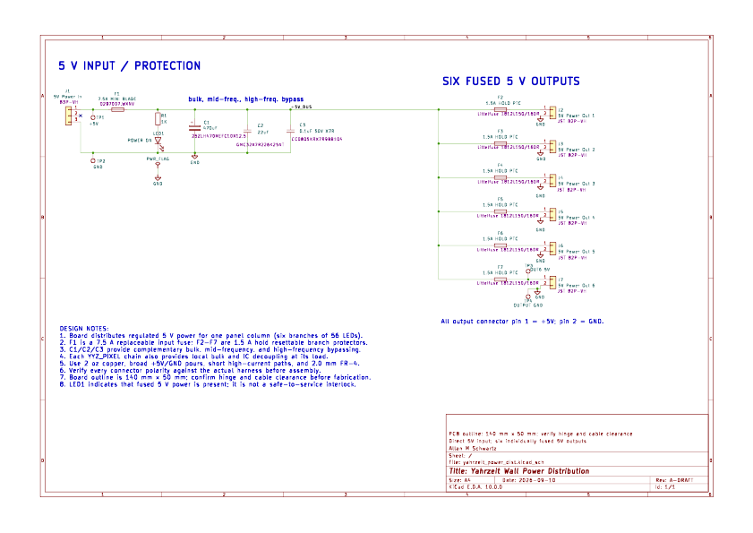
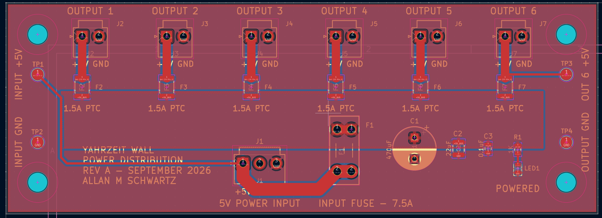
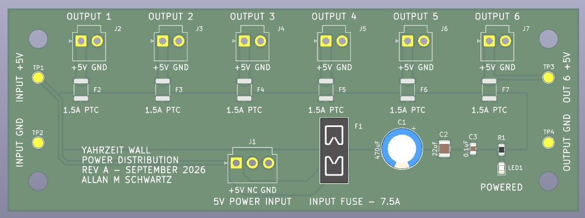
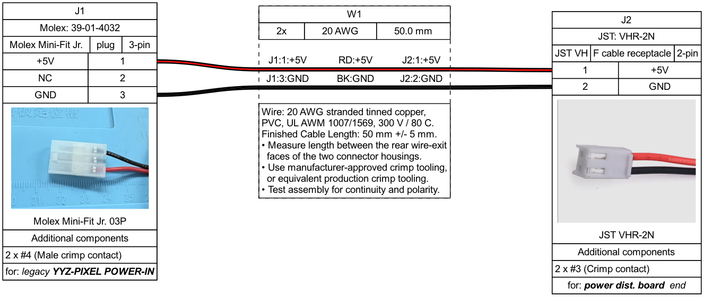
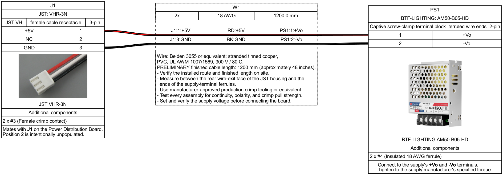

# Yahrzeit Wall 5 V Power Distribution Board

## Purpose

This board replaces the improvised low-voltage distribution wiring for one
column of the Yahrzeit Wall. One assembly accepts regulated 5 V DC from an
external power supply and distributes it to the six YYZ_PIXEL-board chains in
that column. The main input and every output branch have independent
overcurrent protection.

The complete wall has seven panel columns and therefore requires seven working
assemblies. The pricing basis is ten boards: seven for the installed columns
and two spares onsite. Fully cabled spare assemblies remain the service objective;
final cable and power-supply quantities depend on how the spares are equipped.

This is a **direct-5 V distribution board**. The external supply, its output-voltage
adjustment, feed cable, and voltage drop under load are therefore part of the
system design.

The design is ready for prototype pricing and mechanical review, but not yet
for an unchecked production order. Complete the measurements and reviews in
[DESIGN_TODO.md](DESIGN_TODO.md) before fabrication.

## Design illustrations

*Direct-5 V input, main fuse, complementary bypass capacitors, power-present
indicator, and six independently protected outputs. Select the image to open
the PDF schematic.*

*Saved views of the 140 mm × 50 mm design. JST connector bodies are absent
from the 3D view. The KiCad sources are authoritative.*

## Electrical overview

- Input: regulated +5 V and GND through polarized connector J1. J1 pin 2 is
  intentionally unused.
- Main protection: F1 is a replaceable 7.5 A MINI automotive blade fuse in a
  PCB-mounted holder.
- Input filtering: C1 / C2 / C3 provide bulk capacitance, mid-frequency
  bypassing, and high-frequency bypassing after F1.
- Distribution: a broad +5 V copper region feeds six output branches.
- Branch protection: resettable PTC fuses F2 through F7 protect outputs J2
  through J7 independently.
- Output connectors: J2 through J7 use pin 1 for +5 V and pin 2 for GND.
- Power indication: LED1 and R1 indicate that fused +5 V is present. The LED is
  advisory only and is not a safe-to-service interlock.

The front layer contains a shaped `+5V_BUS_PLANE` and a surrounding GND pour.
The back layer is a GND plane. C1, C2, and C3 straddle the +5 V/GND boundary.
The bus region is approximately 13.5 mm wide and includes F1 pin 1 and
F2–F7 pin 2. J1 pin 1 feeds F1 pin 2 through a nominally 3 mm-wide trace;
each PTC-to-output trace is 2 mm wide and carries only its branch current.

TP1/TP2 sit between the left mounting holes and measure the raw input and
GND. TP3/TP4 sit between the right mounting holes; TP3 measures protected
output 6 and is labeled `OUT 6 +5V`. R1 and LED1
sit below J7, with the indicator powered after F1 and labeled `POWERED`.
The indicator does not establish that all six PTC-protected outputs are live.

## Connector and cable interfaces

| Connector | Function | Pin 1 | Pin 2 | Pin 3 |
|---|---|---|---|---|
| J1 | Regulated 5 V input | +5 V | Not connected | GND |
| J2–J7 | Protected pixel-chain outputs | +5 V | GND | — |

Connector polarity must be checked against physical mating housings and the
completed cable drawings before fabrication or connection to a pixel chain.

### J2-J7 output cable: CBL-02

Each protected output uses one CBL-02 adapter cable. Six identical cables are
required per distribution board. The JST VHR-2N end mates with J2-J7 on this
board; the Molex Mini-Fit Jr. 03P end mates with the legacy YYZ-PIXEL POWER-IN
receptacle. Circuit 2 of the three-position legacy connector is intentionally
unpopulated.

*CBL-02 is presently specified as two 18 AWG conductors with a finished length
of 50 mm ±5 mm. Verify the required installed length before ordering.*

The editable WireViz source is
[`cables/CBL-02-molex-p-to-jst-vh-50mm.yml`](cables/CBL-02-molex-p-to-jst-vh-50mm.yml).
Run `make` within `cables/` to regenerate its HTML, PNG, SVG, and TSV BOM.

### J1 supply cable: CBL-PD-01 (preliminary)

The J1 input cable mates with the board's three-position JST B3P-VH header and
connects to the regulated 5 V supply. The preliminary drawing uses two 18 AWG
conductors and an installed length of 1200 mm (approximately 48 inches). That
length must be measured and confirmed on site before manufacture.

The editable WireViz source is
[`cables/CBL-PD-01-jst-vh-to-5v-supply.yml`](cables/CBL-PD-01-jst-vh-to-5v-supply.yml).

Selected terminations:

- Board-end housing: JST `VHR-3N`, DigiKey `455-1184-ND`.
- Board-end contacts: two JST `SVH-21T-P1.1` socket contacts for 18-22 AWG,
  DigiKey cut-tape `455-1133CT-ND`; J1 position 2 remains unpopulated.
- Supply-end terminations: two Phoenix Contact `3200030` insulated ferrules
  for 18 AWG/1.0 mm² wire, with 8 mm contact length; DigiKey `277-2188-ND`.
- Red connects J1 pin 1 to `+Vo`; black connects J1 pin 3 to `-Vo`.

The BTF-LIGHTING supply uses captive screw-clamp terminals. Do not substitute
fork or ring terminals. Confirm ferrule fit, terminal tightening torque, wire
route, strain relief, labels, and continuity/polarity testing before release.

### Cable fabrication plan — September 28, 2026

We have received all the ordered crimpers and wire and will first
experiment with making the cables locally. Build and inspect sample JST VH,
Molex Mini-Fit Jr., and ferrule terminations, check continuity and polarity,
and confirm fit and installed lengths before producing the complete set.
Record material cost and assembly time; PCBWay cable fabrication remains an
alternative if local production is impractical. No cable-fabrication quote
has been received.

## Mechanical and fabrication intent

- Board outline: 140 mm × 50 mm; outputs spaced at 20 mm centers.
- Board material: 2.0 mm FR-4; KiCad board thickness is set to 2.0 mm.
- Copper weight: 2 oz finished copper selected for the fabrication quote.
- Fabrication: two layers, green solder mask, white silkscreen, lead-free HASL.
- Mounting: four 4.5 mm mounting holes for attachment to plywood, with centers
  7.5 mm from each adjacent edge.
- Installation: behind a hinged wall panel, with all connectors and fuses
  accessible for service.
- Construction: broad +5 V distribution copper, front and back GND copper,
  short protected branches, and no intentional narrow high-current
  bottlenecks.
- Identification: the input, six outputs, fuses, test pads, polarity, and
  power-present LED are labeled on the front silkscreen.

Before final fabrication, verify the board outline, mounting locations, hinge
clearance, connector access, fuse-removal clearance, LED visibility, and cable
bend radius with a full-size print, STEP model, or physical mockup.

## Design files

- `yahrzeit_power_dist.kicad_pro` — KiCad project
- `yahrzeit_power_dist.kicad_sch` — authoritative schematic source
- `yahrzeit_power_dist.kicad_pcb` — authoritative PCB source
- `power_dist_schematic.pdf` — schematic for reviewers without KiCad
- `power_dist_schematic.png` — README rendering of the schematic
- `yahrzeit_power_dist.PCBview.png` — saved PCB layout view
- `yahrzeit_power_dist.3Dview.png` — saved 3D view; JST models absent
- `yahrzeit_power_dist.pretty/` — project-specific footprints
- `cables/` — local WireViz cable sources, connector images, and generated
  cable documentation
- `DESIGN_TODO.md` — remaining validation and release checks

## Component selection / preliminary BOM

Prices below are preliminary quantity-one reference prices.
This list to be refreshed when the DigiKey order is prepared. 
The cost column is per part, not the extended cost for one board.

| Designator | Description | Manufacturer part number | Mount | Qty/board | Qty. 1 cost (USD) |
|---|---|---|:---:|---:|---:|
| C1 | 470 µF, 25 V, 105 °C, 10,000 h low-impedance aluminum electrolytic bulk capacitor | Rubycon `25ZLH470MEFC10X12.5` | THT radial, 10 mm body, 5 mm pitch | 1 | 0.67  [DigiKey](https://www.digikey.com/en/products/detail/rubycon/25ZLH470MEFC10X12-5/3563614) |
| C2 | 22 µF, 25 V, X7R mid-frequency ceramic bypass capacitor | Cal-Chip `GMC32X7R226K25NT` | SMD 1210 | 1 | 0.77  [DigiKey](https://www.digikey.com/en/products/detail/cal-chip-electronics-inc/GMC32X7R226K25NT/22461278) |
| C3 | 0.1 µF, 50 V, X7R high-frequency ceramic bypass capacitor | Yageo `CC0805KRX7R9BB104` | SMD 0805 | 1 | 0.17  [DigiKey](https://www.digikey.com/en/products/detail/yageo/CC0805KRX7R9BB104/302874?s=N4IgTCBcDaIMJwAwA5EFYDSAlAGgdiwE4AhYgRkQBYQBdAXyA) |
| F1 | 7.5 A, 32 VDC MINI automotive blade fuse | Littelfuse `0297007.WXNV` | Plug-in | 1 | 0.39  [DigiKey](https://www.digikey.com/en/products/detail/littelfuse-inc/0297002-WXNV/124900?s=N4IgTCBcDaIAxgJwHY4IHQHcAeA7AbiALoC%2BQA) |
| F1 holder | Vertical MINI blade-fuse PCB holder | Keystone `3568` | THT | 1 | 1.37  [DigiKey](https://www.digikey.com/en/products/detail/keystone-electronics/3568/2137306) |
| F2–F7 | Resettable PTC, 16 V, 1.5 A hold current | Littelfuse `1812L150/16DR` | SMD 1812 | 6 | 0.74  [DigiKey](https://www.digikey.com/en/products/detail/littelfuse-inc/1812L150-16DR/3305611) |
| J1 | JST VH, 3-position vertical 5 V input header, 3.96 mm pitch | JST `B3P-VH` | THT | 1 | 0.20  [DigiKey](https://www.digikey.com/en/products/detail/jst-sales-america-inc/B3P-VH/926548) |
| J2–J7 | JST VH, 2-position vertical 5 V output header, 3.96 mm pitch | JST `B2P-VH` | THT | 6 | 0.16  [DigiKey](https://www.digikey.com/en/products/detail/jst-sales-america-inc/B2P-VH/926547) |
| LED1 | Green power-present LED | Kingbright `APT2012CGCK` | SMD 0805 | 1 | 0.21 [DigiKey](https://www.digikey.com/en/products/detail/kingbright/APT2012CGCK/1747526) |
| R1 | 1 kΩ, 1%, 0.125 W power-indicator resistor | Yageo `RC0805FR-071KL` | SMD 0805 | 1 | 0.10   [DigiKey](https://www.digikey.com/en/products/detail/yageo/RC0805FR-071KL/727444?s=N4IgTCBcDaIEoGEAMAOJBWAYnAtEg7AIwDSAMiALoC%2BQA) |
| **Total PCB components per board** | | | | | **$9.28** |

We budget $10 per board for the above PCB components.

## Extra parts for one complete column assembly

These parts are outside the PCB assembly BOM but are required to install one
complete power-distribution assembly. Nine fully equipped assemblies would require nine supplies, nine input cables,
and 52 output adapter cables. Seven installed assemblies alone require seven
supplies, seven input cables, and forty output adapters.

| Item | Description | Part or drawing | Qty/assembly | Unit cost (USD) |
|---|---|---|---:|---:|
| Power supply | Regulated 5 V, 10 A, 50 W adjustable enclosed supply | BTF-LIGHTING `AM50-B05-HD` ([Amazon](https://www.amazon.com/dp/B0FZQNMHN6)) | 1 | $22 |
| Input cable | J1 JST VHR-3N to two 18 AWG ferrules; preliminary 1200 mm length | [`CBL-PD-01`](cables/CBL-PD-01-jst-vh-to-5v-supply.html) | 1 | TBD |
| Output cables | J2-J7 JST VHR-2N to legacy Molex Mini-Fit Jr. 03P; 50 mm length | [`CBL-02`](cables/CBL-02-molex-p-to-jst-vh-50mm.html) | 6 | TBD |

The PCB BOM excludes the external 5 V supply and cable materials. The extra
parts table identifies the required assemblies; the two WireViz cable BOMs are
authoritative for housings, contacts, wire, terminals, and cable quantities.
Labels, and cable-assembly labor remain to be priced or specified.

Do not release this table as a purchasing BOM until every ordering code,
footprint, voltage/current rating, temperature rating, lifecycle status, and
stock level has been checked against the current manufacturer datasheet and
supplier listing.

## Quote and budget record — September 28, 2026

These quotes apply to the previous 140 × 50 mm board. Request updated
pricing for the 140 × 50 mm revision before ordering.

We shall quote the customer **$200 per installed column**, or **$1,400
for seven columns**, with the expectation that actual costs will be lower.
This is the intended customer price, not a supplier quote. 

| Item | Amount (USD) | Basis |
|---|---:|---|
| 10 bare PCBs, 2 oz finished copper | $74.50 | PCBWay quote |
| 10 bare PCBs, 1 oz | $72.72 | Screenshot; comparison only |
| 5 bare PCBs, 2 oz finished copper | $66.87 | PCBWay quote |
| Shipping on ten-board quote | $28.58 | cables will change final shipment cost |

 Power supplies are budgeted at $22 each, or $220 for ten.

The planning estimate for **ten fully equipped assemblies** is
$863–$1,153 before taxes/import charges, with a $1,200 contingency budget:
$82.63 PCBs, about $100 PCB parts, $100–$200 assembly/setup, $240–$360
for sixty fabricated output adapters, $60–$100 for ten fabricated input
cables, $220 for ten power supplies, and $60–$90 for two PCBWay
shipments. Except for the PCB quote, these are allowances, not supplier
prices. That estimate assumed separate populated-board and cable shipments,
not two PCB production runs.

Trying local cable fabrication changes that estimate: replace outsourced
cable charges with actual materials, tooling allocation, and labor, and
reassess the second shipment if cables are no longer ordered from PCBWay.
Installation labor and mains-side wiring were excluded from the estimate.

## Current verification status

- The schematic represents the direct-5 V design.
- The PCB has the direct-5 V component placement and routing.
- The +5 V and GND zones are defined and filled.
- C2 and C3 have +5 V pads in the +5 V region and GND pads in the GND region.
- The 140 × 50 mm revision has no unconnected items and passes targeted
  0.2 mm trace-to-trace/pad clearance checks; final editor DRC remains to run.
- Schematic ERC passes.
- LED1 pin 1 is GND/cathode; pin 2 connects through R1 to the fused bus.
- The customized F1 holder still requires physical 1:1 verification. The
  review 3D render lacked JST connector bodies, so it did not validate plug
  or cable-access clearances.

## Before fabrication

1. Measure worst-case current and voltage on an installed wall column.
2. Confirm the proposed external 5 V supply, its setpoint, and available fault
   current are compatible with F1, F2–F7, the wiring, and the pixel boards.
4. Verify every footprint and connector against a physical sample or
   manufacturer drawing.
6. Generate and independently review Gerbers, drills, BOM, placement data,
   assembly drawings, cable drawings, and service documentation.
7. Build and bench-test a prototype before ordering the complete installation
   quantity.

## Service safety

LED1 indicates that the fused 5 V rail is energized, but an unlit LED does not
prove that the board is safe to handle. Disconnect input power and verify the
rail with a meter before servicing. Work on the mains input, mains wiring, or
the AC-to-DC power supplies must be performed by a qualified person in
accordance with applicable requirements.
