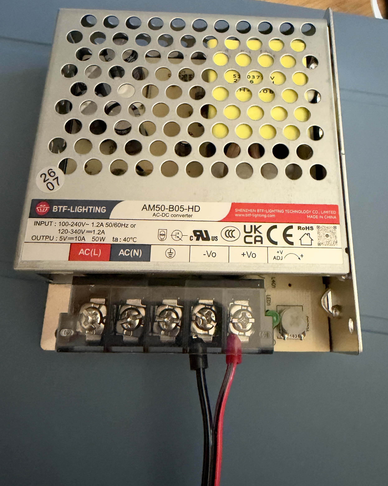
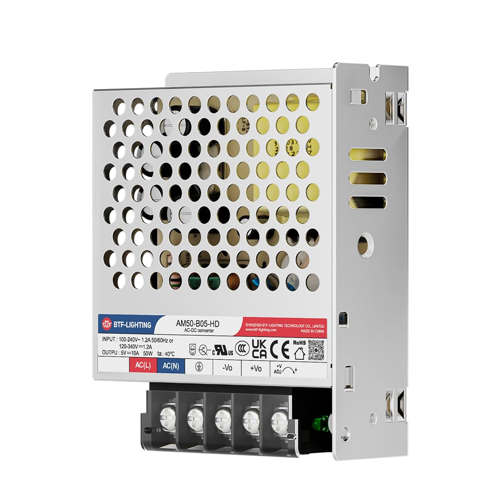

# Yahrzeit Wall 5 V Power Distribution Board

## Purpose

This board replaces the improvised low-voltage distribution wiring for one
column of the Yahrzeit Wall. One assembly accepts regulated 5 V DC from an
external power supply and distributes it to the six YYZ_PIXEL-board chains in
that column. The main input and every output branch have independent
overcurrent protection.

The complete wall has seven panel columns and therefore requires seven working
assemblies. The pricing basis is nine boards: seven for the
installed columns, and two spares onsite. Fully cabled spare assemblies remain the service objective;
final cable and power-supply quantities depend on how the spares are equipped.

This is a **direct-5 V distribution board**. The external supply, its output-voltage
adjustment, feed cable, and voltage drop under load are therefore part of the
system design.

The design is ready for prototype pricing and mechanical review, but not yet
for an unchecked production order. Complete the measurements and reviews in
[DESIGN_TODO.md](DESIGN_TODO.md) before fabrication.

## Design illustrations

*Direct-5 V input, main fuse, complementary bypass capacitors, power-present
indicator, and six independently protected outputs. Select the image to open
the PDF schematic.*

*The KiCad sources are authoritative; verify connector and cable
clearances with physical parts before release.*

## Electrical overview

- Input: regulated +5 V and GND through two-position terminal
  block J1.
- Main protection: F1 is a replaceable 7.5 A mini blade fuse in a
  PCB-mounted holder.
- Input filtering: C1 / C2 / C3 provide bulk capacitance, mid-frequency
  bypassing, and high-frequency bypassing after F1.
- Distribution: a broad +5 V copper region feeds six output branches.
- Branch protection: resettable PTC fuses F2 through F7 protect outputs J2
  through J7 independently.
- Connectors: J1 through J7 are Phoenix Contact `5442206` (BC-508X10-2 GN),
  two-position 5.08 mm-pitch PCB terminal blocks with horizontal wire entry.
  These connectors use pin 1 for +5 V and pin 2 for GND.
- Power indication: LED1 and R1 indicate that fused +5 V is present. The LED is
  advisory only and is not a safe-to-service interlock.

The front layer contains a shaped `+5V_BUS_PLANE` and a surrounding GND pour.
The back layer is a GND plane. C1, C2, and C3 straddle the +5 V/GND boundary.
The fused 5 V input feeds each branch circuit.

TP1/TP2 sit between the left mounting holes and measure input voltage.
TP3/TP4 sit between the right mounting holes and measure one of the fused output voltages.
LED1, powered through R1 from the fused 5 V rail, is labeled `POWERED`.
The indicator does not establish that all six PTC-protected outputs are live.

## Connector and cable interfaces

| Connector | Function | Pin 1 | Pin 2 |
|---|---|---|---|
| J1 | Regulated 5 V input | +5 V | GND |
| J2–J7 | Protected pixel-chain outputs | +5 V | GND |

Connector polarity must be checked against the board silkscreen, power-supply
terminals, and existing cable conductors before connection.

### J2-J7 existing output leads

Reuse the six existing cables that connect this distribution board to the six
YYZ_PIXEL board chains. At the wire nut or distribution end, cut off the obsolete
wire-nut termination and crimp on a ferrule sized for the conductor.
The [Phoenix 5442206](https://www.phoenixcontact.com/en-us/products/printed-circuit-board-terminal-bc-508x10-2-gn-5442206) specifies a 6 mm stripping length;
select a compatible ferrule and strip to its barrel length, with no exposed
conductor outside the terminal.
Keep each cable's existing pixel-board connector intact. With power disconnected,
confirm polarity with a continuity check to the pixel-board connector; retain
red for +5 V and black for GND before clamping each ferrule into J2-J7.

### J1 supply lead

J1 is a two-position screw-clamp terminal.
The supply wire is a short, approximately 24 inch, two-conductor 18 AWG feed from the
regulated 5 V supply. Terminate the supply end with ferrules compatible with
the supply's captive screw-clamp terminals; use compatible ferrules at J1
as well (four ferrules total). Prepare each end for its terminal and ferrule.
Connector J1 is
the same Phoenix terminal block as used at J2-J7.
Confirm the cable route,
length, ferrule fit, tightening torque, continuity, and polarity
before installation. Measure voltage drop under maximum load before approving
18 AWG for the final length. The power supply output is adjustable by ±10%.

## Mechanical and fabrication intent

- Board outline: 140 mm × 50 mm; outputs spaced at 20 mm centers.
- Board material: 2.0 mm FR-4; KiCad board thickness is set to 2.0 mm.
- Copper weight: 2 oz finished copper selected for the fabrication quote.
- Fabrication: two layers, green solder mask, white silkscreen, lead-free HASL.
- Mounting: four 4.5 mm mounting holes for attachment to plywood, with centers
  7.5 mm from each adjacent edge. Mount on standoffs to provide clearance beneath the PCB.
- Installation: behind each hinged wall panel, with all connectors and fuses
  accessible for service.

Before final fabrication, verify the board outline, mounting locations, hinge
clearance, connector access, fuse-removal clearance, LED visibility, and cable
bend radius with a full-size print, STEP model, or physical mockup.

## Design files

- `yahrzeit_power_dist.kicad_pro` — KiCad project
- `yahrzeit_power_dist.kicad_sch` — authoritative schematic source
- `yahrzeit_power_dist.kicad_pcb` — authoritative PCB source
- `power_dist_schematic.pdf` — schematic for reviewers without KiCad
- `power_dist_schematic.png` — README rendering of the schematic
- `yahrzeit_power_dist.PCBview.png` — saved PCB layout view
- `yahrzeit_power_dist.3Dview.png` — saved 3D view; verify current terminal
  block models and wire access against physical parts
- `yahrzeit_power_dist.pretty/` — project-specific footprints
- `enclosure/` — parametric wall enclosure and 4 × 8 box alignment jig
- `DESIGN_TODO.md` — remaining validation and release checks

## Component selection / BOM pricing

PCBWay prices are from quotation `T-V40W07135A` dated October 9, 2026,
for nine assembled boards. DigiKey prices are the unit prices in the saved
shopping cart dated October 7, 2026. Prices are per part; quantities are
extended only in the subtotal.

| Designator | Description | Manufacturer part number | Mount | Qty/board | PCBWay unit price (USD) | DigiKey cart unit price (USD) |
|---|---|---|:---:|---:|---:|---:|
| C1 | 470 µF, 25 V, 105 °C, 10,000 h low-impedance aluminum electrolytic bulk capacitor | Rubycon `25ZLH470MEFC10X12.5` | THT radial, 10 mm body, 5 mm pitch | 1 | 0.150 | 0.670  [DigiKey](https://www.digikey.com/en/products/detail/rubycon/25ZLH470MEFC10X12-5/3563614) |
| C2 | 22 µF, 25 V, X7R mid-frequency ceramic bypass capacitor | Cal-Chip `GMC32X7R226K25NT` | SMD 1210 | 1 | 1.633 | 1.350  [DigiKey](https://www.digikey.com/en/products/detail/cal-chip-electronics-inc/GMC32X7R226K25NT/22461278) |
| C3 | 0.1 µF, 50 V, X7R high-frequency ceramic bypass capacitor | Yageo `CC0805KRX7R9BB104` | SMD 0805 | 1 | 0.049 | 0.180  [DigiKey](https://www.digikey.com/en/products/detail/yageo/CC0805KRX7R9BB104/302874?s=N4IgTCBcDaIMJwAwA5EFYDSAlAGgdiwE4AhYgRkQBYQBdAXyA) |
| F1 | 7.5 A, 32 VDC MINI automotive blade fuse | Littelfuse `029707.5WXNV` | Plug-in; purchased separately | 1 | — | 0.301  [DigiKey](https://www.digikey.com/en/products/detail/littelfuse-inc/029707-5WXNV/146586) |
| F1 holder | Vertical MINI blade-fuse PCB holder | Keystone `3568` | THT | 1 | 1.174 | 1.310  [DigiKey](https://www.digikey.com/en/products/detail/keystone-electronics/3568/2137306) |
| F2–F7 | Resettable PTC, 16 V, 1.5 A hold current | Littelfuse `1812L150/16DR` | SMD 1812 | 6 | 0.086 | 0.612  [DigiKey](https://www.digikey.com/en/products/detail/littelfuse-inc/1812L150-16DR/3305611) |
| J1–J7 | PCB terminal block, 2-position, 5.08 mm pitch, horizontal wire entry | Phoenix Contact `5442206` (BC-508X10-2 GN) | THT | 7 | 0.276 | 0.500 est. [DigiKey](https://www.digikey.com/en/products/detail/phoenix-contact/5442206/4390264) |
| LED1 | Green power-present LED | Kingbright `APT2012CGCK` | SMD 0805 | 1 | 0.140 | 0.220  [DigiKey](https://www.digikey.com/en/products/detail/kingbright/APT2012CGCK/1747526) |
| R1 | 1 kΩ, 1%, 0.125 W power-indicator resistor | Yageo `RC0805FR-071KL` | SMD 0805 | 1 | 0.014 | 0.100  [DigiKey](https://www.digikey.com/en/products/detail/yageo/RC0805FR-071KL/727444?s=N4IgTCBcDaIEoGEAMAOJBWAYnAtEg7AIwDSAMiALoC%2BQA) |
| **Installed PCB-component subtotal per board** | | | | | **$5.608** | **$11.002** |

PCBWay's installed-component total is $50.472 for nine boards. The plug-in
fuses are purchased separately and therefore are excluded from both
subtotals. The DigiKey cart reflects the change from Phoenix Contact `1715721`
to `5442206`.

## Extra parts for one complete column assembly

These items are outside the PCB assembly BOM. The existing six pixel-chain
cables are reused for each board; only their board-end terminations are
converted to ferrules. A short supply lead is required for each installed
assembly.

| Item | Description | Part or drawing | Qty/assembly | Unit cost (USD) |
|---|---|---|---:|---:|
| Power supply | Regulated 5 V, 10 A, 50 W adjustable enclosed supply | BTF-LIGHTING `AM50-B05-HD` ([Amazon](https://www.amazon.com/dp/B0FZQNMHN6)) | 1 | $22 |
| Input lead | Two-conductor 18 AWG supply feed, approximately 24 inches; both ends ferruled | n/a | 4 ferrules  24" wire | Negligible—bulk supplies |
| Output lead preparation | Two ferrules per existing J2-J7 cable; six cables are reused | n/a | 12 ferrules | Negligible—bulk supplies |
| 3D printed case | | | | bulk supplies |
| 3mm screws  | with threaded inserts in the case | | | bulk supplies |

The PCB BOM excludes the external 5 V supply, input lead, and ferrules. Bulk and lab supplies will be roughly $50 for the total project.

*Do not release this table as a purchasing BOM until every ordering code,
footprint, voltage/current rating, temperature rating, lifecycle status, and
stock level has been checked against the current manufacturer datasheet and
supplier listing.*

## Quote and budget record — October 9, 2026

PCBWay quotation `T-V40W07135A` covers ten fabricated PCBs and nine assembled
boards using the screw-terminal design. Shipping is not yet included.

We shall quote the customer **$60 per installed column**, or **$600
for one prototype, seven columns, and two spares**,
with the expectation that actual costs will be lower.
This is the intended customer price, not a supplier quote.

| Item | Amount (USD) | Basis |
|---|---:|---|
| 10 bare PCBs, 2 oz finished copper | $74.50 | PCBWay quote |
| Components for 9 assembled boards | $50.472 | PCBWay BOM quote |
| Assembly labor for 9 boards | $29.00 | PCBWay quote |
| V3 member discount | −$3.105 | PCBWay quote |
| **PCBWay order subtotal** | **$150.867** | Before shipping |
| 10 bare PCBs, 1 oz | $72.72 | Screenshot; comparison only |
| 5 bare PCBs, 2 oz finished copper | $66.87 | PCBWay quote |
| Shipping on previous ten-board quote | $28.58 | Confirm for the final order |

Power supplies are budgeted at $22 each, or $220 for ten.

Recalculate the installed-system budget using actual component prices and
bulk-supply quantities. The existing pixel-chain cables are reused; sixty new
output cables are not required. Installation labor will be *pro bono*;
mains-side wiring is excluded from this budget.

## Current verification status

- The schematic represents the direct-5 V design.
- KiCad CLI DRC reports zero board violations and zero unconnected pads.
- Schematic ERC passes.
- The customized F1 holder still requires physical 1:1 verification. Confirm
  the terminal-block bodies, screw access, wire entry, ferrule insertion, and
  cable bend/strain relief against physical parts; the saved 3D view alone is
  not sufficient for that review.

## Before fabrication

1. Measure worst-case current and voltage on an installed wall column.
2. Confirm the proposed external 5 V supply, its setpoint, and available fault
   current are compatible with F1, F2–F7, the wiring, and the pixel boards.
3. Verify every footprint and connector against a physical sample or
   manufacturer drawing.
4. Generate and independently review Gerbers, drills, BOM, placement data,
   assembly drawings, cable drawings, and service documentation.
5. Build and bench-test a prototype before ordering the complete installation
   quantity.

## Service safety

LED1 indicates that the fused 5 V rail is energized, but an unlit LED does not
prove that the board is safe to handle. Disconnect input power and verify the
rail with a meter before servicing. Work on the mains input, mains wiring, or
the AC-to-DC power supplies must be performed by a qualified person in
accordance with applicable requirements.
